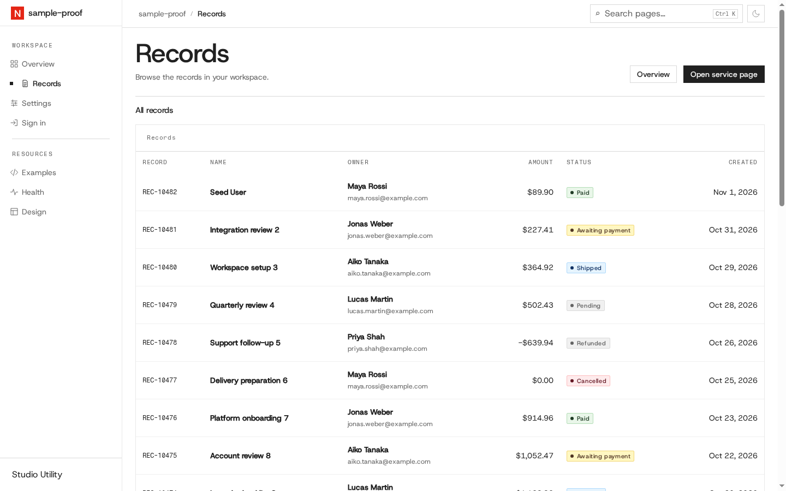

# Live seeded proof — 2026-11-01

Deno 2.9.7; maintainer init with sqlite, users service and User model, no Aspire. Fresh app and service ran as processes owned by this run; no shared containers were changed.

- Real Prisma migration and client/Zod generation: exit 0.
- Database seed: 40 rows; second seed retained 40 rows.
- REST list: HTTP 200. Status=paid, page=2, limit=3 and amount ascending returned three sorted paid rows with total=7.
- Generated source check: SQLite 133 files and memory 125 files, no findings. Memory emitted application test: 1 passed.
- Home and records HTTP 200. Chromium 153 headless DOM passed the existing runtime assertion for REC-10482, Maya Rossi, maya.rossi@example.com, Paid and $89.90 in actual table/detail cells (scripts excluded).
- Live typed service client → generated pure overview projector: ready; 20 records in each adjacent 30-day period; sixty zero-filled daily buckets; status counts cover all forty rows; latest five begin REC-10482.

Raw process logs, DOM and command receipts remain private project run output. Final CI URLs and committed-head results are published on PR #2583.
