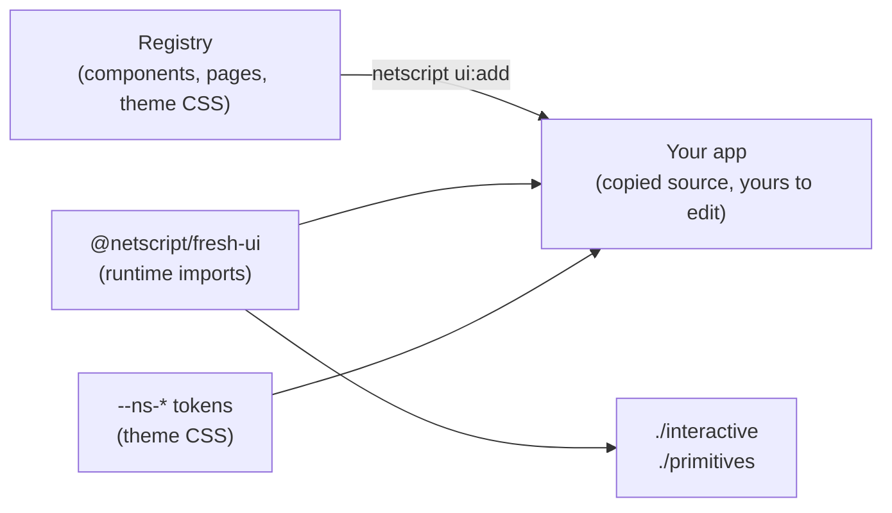

# @netscript/fresh-ui

[](https://jsr.io/@netscript/fresh-ui)
[](https://github.com/rickylabs/netscript/actions/workflows/ci.yml)
[](https://rickylabs.github.io/netscript/)

**The design system for NetScript's Fresh web surface: a copy-source component registry, a semantic
`--ns-*` token vocabulary, and a small package-owned runtime of accessible interactive primitives
and helpers.**

Component libraries force a choice: import a black box you cannot restyle, or copy code that drifts
the moment it lands. This package splits the difference. Components, pages, and theme CSS live in a
registry that the NetScript CLI copies **into your app** — from that point the code is yours to own
and evolve — while the genuinely shared parts (class merging, toast plumbing, icons, accessible
interaction state machines) stay in the package and update with it.

Everything copied and everything imported speaks one visual language: a theme-driven `--ns-*`
custom-property vocabulary that keeps components and themes decoupled. Restyle the app by swapping
tokens; the components never know.

## Why teams use it

- **Copy-source registry** — `netscript ui:init` installs the foundation, `netscript ui:add <item>`
  copies themed components, pages, and collections into your app; once copied, the code is yours.
- **Semantic token vocabulary** — registry CSS targets `--ns-*` custom properties, so themes and
  components stay decoupled and a token swap restyles the whole surface.
- **Accessible interactive primitives** — `Accordion`, `Combobox`, `Dialog`, `Drawer`, `Popover`,
  `Sheet`, `Tabs`, and `Tooltip` compound namespaces emit `data-part`, `data-state`, and ARIA
  attributes for styleable, accessible behavior.
- **Runtime helpers** — `cn` for class merging and the redirect-flash `withToast` / `getToast` /
  `stripToastFromUrl` cycle for carrying notifications across server redirects.
- **Generative-UI renderer** — `./ai/render-ui` safely renders AI `render_ui` tool payloads through
  a curated block whitelist, a recursion depth guard, and named fallbacks instead of throws.
- **AI surface collection** — `netscript ui:add ai` installs the chat seams: message thread,
  composer, model picker, tool-call disclosure, and the widget island that renders MCP `ui://`
  resources.
- **Native desktop chrome** — `createDesktopChrome` on `./desktop` activates application menus,
  tray, dialogs, notifications, and window actions around an existing Deno Desktop window, and
  returns an inert browser-safe lifecycle everywhere else.

`CodeBlock` highlights recognized `lang` names and aliases (such as `ts`, `javascript`, and `json`)
with the common highlight.js language set. Unknown or omitted languages remain plain text. Source
is escaped before syntax spans are added, and the copy payload remains the original source. The
copied component keeps clipboard handling in the app's island. Studio Utility binds the syntax
classes to its light/dark `code/syntax/*` roles.

## Architecture



## Install

```bash
deno add jsr:@netscript/fresh-ui@<version>
```

Pin `<version>` to match your installed CLI; bare `jsr:@netscript/*` specifiers do not resolve on
the pre-release line. In a scaffolded NetScript workspace, `netscript ui:init` wires the pinned
entry and the theme foundation for you.

## Quick example

The runtime helpers work anywhere Preact renders:

```typescript
import { cn, getToast, stripToastFromUrl, withToast } from '@netscript/fresh-ui';

// Merge class names safely (clsx + tailwind-merge semantics).
const buttonClass = cn('ns-btn', 'app-action');

// Carry a redirect-flash toast across a server redirect.
const redirectTo = withToast('/dashboard/deployments', {
  type: 'success',
  title: 'Deployment queued',
  message: 'api-gateway will roll out to three regions.',
});

// Read the toast back on the destination route, then clean the URL.
const url = new URL(`https://app.example${redirectTo}`);
const toast = getToast(url); // RegistryToast | undefined
const cleanPath = stripToastFromUrl(url); // '/dashboard/deployments'
```

Typed components come from the root entrypoint; stateful interactive components live on
`./interactive`, and headless layout primitives on `./primitives`:

```tsx
import { DataGrid } from '@netscript/fresh-ui';
import { Dialog } from '@netscript/fresh-ui/interactive';
import { Icon, Show, VisuallyHidden } from '@netscript/fresh-ui/primitives';

type Session = { name: string; tokens: number; status: string };

<DataGrid<Session>
  label='Recent sessions'
  columns={[
    { key: 'name', header: 'Session', cell: 'strong' },
    { key: 'tokens', header: 'Tokens', width: '8rem', cell: 'num' },
    { key: 'status', header: 'Status', render: (row) => <span>{row.status}</span> },
  ]}
  rows={[
    { id: 'vs3', data: { name: 'VS3', tokens: 18420, status: 'active' }, href: '/sessions/vs3' },
  ]}
/>;
```

Controlled collection actions are opt-in; omitting these props keeps the existing caller data and callback shape:

```tsx
import { DataGrid } from '@netscript/fresh-ui';
import type { DataGridColumn, DataGridRow } from '@netscript/fresh-ui';
import { ActionMenu } from '@netscript/fresh-ui/interactive';

type Session = { name: string; tokens: number; status: string };

declare const columns: readonly DataGridColumn<Session>[];
declare const rows: readonly DataGridRow<Session>[];
declare const selectedIds: ReadonlySet<string>;
declare const setSelectedIds: (next: ReadonlySet<string>) => void;

<DataGrid<Session>
  columns={columns}
  rows={rows}
  selectedIds={selectedIds}
  onSelectionChange={setSelectedIds}
  renderBulkActions={({ count }) => <button>Archive {count}</button>}
  renderRowActions={(session) => (
    <ActionMenu.Root>
      <ActionMenu.Trigger aria-label={`Actions for ${session.name}`}>•••</ActionMenu.Trigger>
      <ActionMenu.Content>
        <ActionMenu.Item>Rename</ActionMenu.Item>
        <ActionMenu.Item intent='destructive'>Delete</ActionMenu.Item>
      </ActionMenu.Content>
    </ActionMenu.Root>
  )}
/>;
```

## API at a glance

| Entry            | What it gives you                                                                                |
| ---------------- | ------------------------------------------------------------------------------------------------ |
| `.`              | `cn`, `withToast` / `getToast` / `stripToastFromUrl`, `DataGrid`, `Icon`                         |
| `./interactive`  | `ActionMenu`, `Accordion`, `Combobox`, `Dialog`, `Drawer`, `Popover`, `Sheet`, `Tabs`, `Tooltip` |
| `./primitives`   | `Icon`, `Show`, `SrOnly`, `VisuallyHidden` — headless platform primitives                        |
| `./ai/render-ui` | `RenderUiSurface`, `renderUiPayload` — the safe generative-UI renderer                           |
| `./desktop`      | `createDesktopChrome` — menus, tray, dialogs, notifications, window actions                      |
| `./registry`     | The registry manifest and content map the CLI copies from                                        |
| `./tokens`       | DTCG sources, preset metadata and the IO-free Style Dictionary builder for tooling                |

The always-current symbol list is
[`deno doc jsr:@netscript/fresh-ui@<version>`](https://jsr.io/@netscript/fresh-ui/doc).

The token builder is a tooling entrypoint. Import it from CLI or build code:

```typescript
import { buildTokens } from '@netscript/fresh-ui/tokens';

const build = await buildTokens({
  preset: 'studio-utility',
  override: {
    semantic: {
      'radius-md': { $type: 'dimension', $value: '{semantic.radius-lg}' },
    },
  },
});
// The caller chooses the destination and writes the returned bytes.
console.log(build.files['tokens.css']);
```

All 24 presets, both schemes and both requested density contexts build through
Style Dictionary. Presets fix their own geometry. Studio Utility is the default for new applications; NS One remains a legacy preset;
Studio Utility is available as `theme-studio-utility` in the registry. The
three-tier source and extension guide is [tokens/README.md](tokens/README.md).

## Component contracts

Import types and the JSON serializer from `@netscript/fresh-ui/contracts`. This pure-data
subpath describes props, anatomy, data attributes, slots, APG patterns, keyboard maps and token
roles shared by styles. It performs no IO. See [the contributor guide](src/contracts/README.md)
for native, pseudo-element and planned-part representations.

## Docs

- **Web layer — the design system in context**:
  [rickylabs.github.io/netscript/web-layer/](https://rickylabs.github.io/netscript/web-layer/)
- **Reference**:
  [rickylabs.github.io/netscript/reference/fresh-ui/](https://rickylabs.github.io/netscript/reference/fresh-ui/)
- **How-to — customize Fresh UI**:
  [rickylabs.github.io/netscript/how-to/customize-fresh-ui/](https://rickylabs.github.io/netscript/how-to/customize-fresh-ui/)
- **API docs on JSR**: [jsr.io/@netscript/fresh-ui/doc](https://jsr.io/@netscript/fresh-ui/doc)

## Compatibility

Runs on Deno 2.x with Preact; the runtime helpers are pure functions and render in any modern
browser. Registry copy commands (`netscript ui:*`) require the NetScript CLI.

## License

Apache-2.0 — see [LICENSE](https://github.com/rickylabs/netscript/blob/main/LICENSE). Published to
JSR with cryptographically verified provenance.

Token build metadata is available from `@netscript/fresh-ui/token-config` without
loading Style Dictionary or the source corpus. See [token contribution and output
budgets](tokens/README.md). Design preview styles are opt-in through
`netscript ui:add theme-previews` or `netscript tokens build --previews`.

The catalog is available as `componentContracts` from `./contracts`, or as a JSON module:

```ts
import { componentContracts, serializeComponentContracts } from '@netscript/fresh-ui/contracts';
import catalog from '@netscript/fresh-ui/contracts.json' with { type: 'json' };

console.log(componentContracts.components.find((component) => component.name === 'button'));
console.log(serializeComponentContracts(componentContracts));
console.log(catalog.schemaVersion);
```

The catalog covers all 104 Figma inventory identities. `shipped: false`, planned values and
native/pseudo parts distinguish specified anatomy from a rendering implementation. Phase 2
adds registry components with real render and browser keyboard coverage; it preserves token values.

The `actions` collection includes ButtonGroup, Toggle and ToggleGroup. The `forms-core`
collection includes RadioGroup, InputGroup, InputOTP, Slider, Calendar and DatePicker.
Install individual items with `netscript ui:add calendar` or `netscript ui:add date-picker`.
Hydrate interactive controls inside a Fresh island.

Calendar accepts ordered ISO date strings through `value`/`defaultValue`, plus
`mode='single' | 'range'`, `months={1 | 2}`, `caption='label' | 'dropdown'`,
`min`/`max`, `isDateDisabled`, `weekStartsOn` and `onValueChange`. Its `today`
default is UTC; supply the user's local ISO day when local-day highlighting is needed.
Arrow keys browse enabled dates, Home/End move within the week, PageUp/PageDown
move months (Shift moves years), and Enter/Space select.

DatePicker adds a required `label`, optional form `name`, and independently controlled
`open`/`onOpenChange`. Its native modal Dialog supports Escape/Cancel and returns focus
to the trigger. Selection requests respect controlled values; ordinary closing requests respect
controlled open state. Browser-forced dismissal (such as repeated Escape) remains
native behavior; apps should normally accept native close requests. Reopening starts on the selected month. A named hidden input
submits the ISO date, or range endpoints joined by `/`.

The `navigation` collection adds NavigationMenu, Menubar, LocationMarker and Stepper.
NavigationMenu uses native exclusive details disclosures and ordinary site links.
Menubar accepts menu records with actions, controlled checkbox/radio choices,
labels, separators and nested submenu records. It delegates native popovers to
ActionMenu; arrow keys, Home/End, typeahead, Escape and Tab follow the application
menu pattern. Hydrate it in an island; application callbacks and choice state
belong to the app. `value`/`onValueChange` may control the open menu ID (`null` closes).

ActionMenu.Item supports `role='menuitemcheckbox' | 'menuitemradio'`, native
`aria-checked`, and `closeOnSelect={false}` for repeated choice adjustments.
ActionMenu.Content supports `initialFocus='first' | 'last'`. Outside dismissal
keeps the destination focus; explicit Escape/close actions return to the trigger.
Stepper is an ordered list with per-step status and optional native links, and
LocationMarker is decorative. Neither adds a composite keyboard manager.

The `overlays` collection adds AlertDialog, HoverCard and ContextMenu. AlertDialog
requires trigger/title/description/action labels and delegates modal focus to
Dialog; Cancel is the initial focus target and outside clicks do not dismiss.
Application callbacks, pending state and controlled open state remain caller-owned.
HoverCard opens on hover, focus or button activation without moving focus, and
keeps content usable across pointer transfer. Touch/pen use activation-only toggles;
mouse hover previews and a subsequent click closes the preview. Its description/meta/avatar are
content slots. ContextMenu accepts ordinary region content plus menu records,
opens at pointer coordinates or with Shift+F10/ContextMenu, and shares the
action/choice/submenu behavior of Menubar. Hydrate these controls in islands.

AlertDialog's Utility destructive action uses the canonical destructive fill and
foreground roles. Its scoped hover binds destructive/hover rather than the generic
legacy Button's raw red ramp. The existing text/card inversion is removed; shared
token values remain owned by the token workstream and are unchanged here.

Data display additions: `ui:add item kbd collapsible` copies presentation rows, native keyboard notation and native details disclosures. Item retains native child links/actions; Kbd adds no focus targets; after hydration, Collapsible supports controlled open refusal and blocks disabled summary activation. Before hydration, its summary retains native disclosure behavior.

`ui:add chart carousel` adds token-driven Cartesian series and a manual native scroll-snap carousel. Chart accepts one to three labeled `series` and `data` rows with matching finite numeric `values`; its native data disclosure exposes exact values to keyboard and assistive technology. Hover is supplemental. Carousel supports horizontal/vertical orientation, inside/outside controls, dots, counter and a clamped `defaultIndex`; it has no autoplay. Boundary controls retain focus with guarded `aria-disabled`, and inactive slide content becomes inert after hydration.

Chart uses an explicit `locale` (`en-US` by default) for consistent server/client number formatting. When native carousel scrolling moves away from a focused slide link, focus moves to the existing scroll viewport before that slide becomes inert; previous/next/dot focus stays on its native control.

`ui:add code-block` copies single-file, tabbed and diff code surfaces. Hydrate the component in an island for file selection and clipboard feedback. `tabs` contains uniquely keyed `{ value, label, code?, filename?, lang?, lines? }` files; `value`/`defaultValue` and `onValueChange` control selection. Horizontal arrows follow the document direction; Home/End select the first/last file. Code itself retains left-to-right native horizontal scrolling. `header={false}` hides optional metadata/copy chrome while retaining essential file tabs.

`lineNumbers`, `footer`, `footerContent`, `scrollbar`, `size` and `tone` customize the surface. Diff `lines` carry raw `text`, optional `number` and `variant` (`default`, `added`, `removed`, `highlighted`); visible plus/minus signs supplement color. Raw text is escaped. Recognized lang names/aliases use deterministic highlight.js common output, preserving multiline syntax across display rows; each file uses its own language, and unknown names remain plain. Explicit row content overrides automatic highlighting. Diff rows share one displayed source, so removed and added lines can share lexical state; use explicit row content when old and new syntax need independent interpretation. Trusted syntax content can use `CodeBlock.Token` with existing keyword/function/type/string/number/comment/punctuation roles. Clipboard writes use the exact `code` when supplied, otherwise resulting row text excluding removals. `onCopied(source)` and `onCopyError(error)` report actual outcomes; native `onCopy` remains a DOM clipboard event. A pending copy cannot mark a newly selected file copied. The optional `state` prop is a controlled visual snapshot. Published phase-one variant/header aliases remain supported.

Syntax colors use existing code roles directly on `code/bg`. Tinted diff/highlight rows use a contextual 80% syntax / 20% text-foreground mix to retain each syntax hue with readable small-text contrast. All seven syntax roles are measured against all four row surfaces in the real Utility browser matrix; diff signs remain explicit. No shared token values change.

Legacy `header="tabs"` without a file collection renders the filename/copy header (`data-header="title"`); only explicit `variant="tabbed"` requires a nonempty file collection. The contract retains the legacy alias list alongside its boolean chrome control.

`Label variant='eyebrow'` uses the existing Utility metadata typography. `optional`/`optionalText` add a hint; `required` takes precedence. `srOnly` keeps the native accessible name without a visible label. `state='disabled' | 'invalid'` styles the label; set disabled/invalid semantics on the associated input itself. Native `for`/`htmlFor` association and scope overrides remain available.

`Card variant='rule' size='sm'` provides the docs surface with a top border, no resting fill/radius/shadow and compact sections. Existing Header/Title/Description/Body/Footer composition remains, with optional `Card.Action`. Section visibility follows composition. `interactive` enables hover/focus-within styling; the card adds no aggregate tab stop or click handler. Native child actions retain their behavior; `state` can supply a visual snapshot.

`Pagination variant='pager'` composes `Pagination.Previous` and `Pagination.Next` with native `href` destinations and automatic previous/next relations. Numbered pagination retains Meta/Actions and adds Link/current/disabled plus decorative Ellipsis. Disabled destinations have no href or tab stop and block activation callbacks. Horizontal arrows mirror with document direction; narrow layouts stack document tiles. The existing Icon primitive also supports arrow-left/right, sourced from [Lucide](https://lucide.dev/icons/arrow-left) with its Lucide/Feather notices retained in source.

### StatsGrid metrics

`ui:add stats-grid` installs the responsive block and its existing theme/layout/Card dependencies.
Keep the automatic column layout, or cap it with `columns={2}`, `3` or `4`. Every mode adapts to the
container: a narrow rail still stacks its cards. `joined` creates one ruled strip, including when
cards wrap. Both options belong to the grid; `variant` and `delta` belong to each card.

```tsx
import { StatsGrid } from './components/ui/stats-grid.tsx';

<StatsGrid columns={3} joined>
  <StatsGrid.Card
    label='Net revenue'
    value='$284,920'
    variant='hero'
    delta='up'
    detail='+8.2% versus the previous 30 days'
  />
  <StatsGrid.Card label='Orders' value='3,182' detail='Same period' />
  <StatsGrid.Card label='Average order value' value='$89.54' delta='down' detail='-1.3%' />
</StatsGrid>;
```

`StatsGrid.Card` keeps `label`, `value`, optional `detail` and `badge`, native attributes and classes.
`variant` defaults to `default` (also `hero`); `delta` defaults to `none` (also `up` and `down`).
The arrow appears only when `detail` is supplied. It is decorative: include the sign and meaning in the caller's `detail` text. Badge and
supporting-content controls keep native Tab, Enter and Space behavior; neither the grid nor its cards
add focus stops or handlers. The card retains the `ns-card` class while owning its stat-specific axes.

`icon`, `sparkline`, `ticks` and `blockbars` accept optional caller-owned decorative content and are
empty by default. Their wrappers are inert and hidden from assistive technology; put controls in
`badge` or `detail`. Theme roles `--ns-deco-sparkline`, `--ns-deco-ticks` and `--ns-deco-blockbars`
enable the corresponding content with value `1`, using native CSS style queries. Disabled roles and
browsers without style-query support hide these decorations with no layout space. Utility disables
all three. No series, fetching or chart engine is synthesized. Grid, borders, surfaces and typography
consume the existing KPI/theme roles; no token values change.

### DataTable composition and native DataGrid

`ui:add data-table` installs the copied frame and the stylesheet that also styles package `DataGrid`.
Importing `DataGrid` from the package alone does not install CSS. A frame-only installation leaves
the package optional: use `deno add jsr:@netscript/fresh-ui` when consuming package `DataGrid`; the
static copied frame does not require or create that package mapping. Both remain the same canonical
DataTable identity: use `DataTable.Header`, `.Body` and `.Footer` to compose host-owned controls,
with a `DataGrid` inside the body. The frame's `state` defaults to `default`; it also accepts
`selection`, `empty` and `loading`. Loading exposes native busy state. `DataTable.Row` keeps its
optional `cols` grid template and preserves native string or object styles.

```tsx
import { DataGrid } from '@netscript/fresh-ui';
import { DataTable } from './components/ui/data-table.tsx';

<DataTable>
  <DataTable.Header>Recent sessions</DataTable.Header>
  <DataTable.Body>
    <DataGrid
      label='Recent sessions'
      columns={[
        { key: 'name', header: 'Session', cell: 'strong' },
        { key: 'tokens', header: 'Tokens', cell: 'num' },
      ]}
      rows={[{
        id: 'vs3',
        label: 'Open session VS3',
        data: { name: 'VS3', tokens: 18420 },
        href: '/sessions/vs3',
      }]}
    />
  </DataTable.Body>
  <DataTable.Footer>Caller-owned pagination</DataTable.Footer>
</DataTable>;
```

DataGrid uses a native table containing independent native controls. Tab/Shift+Tab move through
buttons, links and checkboxes; Enter activates buttons and links, Space activates buttons and
checkboxes. It adds no grid focus manager. Row activation is a native button (`onSelect`) or Fresh
link (`href`) inside a cell, with primary body clicks forwarded to that native control. Arbitrary caller-rendered cell content
is its sibling, so cell links, inputs and row actions keep their own behavior. A row's optional
`label` names this activation and can localize the fallback `Open row <id>`. Control/Meta primary body clicks use the owned native link with a temporary new-tab target,
restored after activation. Shift, Alt and combined-modifier body clicks are not forwarded; use the
visible native link for those operations. Body clicks are delegated activations; direct controls
retain raw native event semantics. Middle-click and the native link
context menu are available directly on the visible row-link arrow; auxiliary body clicks are not
forwarded. Native text selection stays available. Control/Meta body clicks on `onSelect` rows activate their
button normally. Selection and action cells retain their existing click-propagation isolation; other
independent controls keep their native behavior. The serialized `aria-checked` hint remains for
compatibility and updates with the same accepted render as the authoritative native checked and
indeterminate properties. Selection checked and
mixed properties are controlled; refusing `onSelectionChange` preserves the actual checkbox state.
`selected` row snapshots remain available without a controlled set, and stale IDs do not inflate
the visible selected count.

`DataGridColumn.header` now accepts the existing `DataGridRenderable` type, including a native sort
button. `sort` sets `aria-sort` on the native column header; the caller owns ordering and state.
`headerLabel` supplies a noninteractive mobile cell label and defaults to a string header or the
column key. Narrow containers stack rows while keeping header controls reachable, including inside a wide viewport.

DataGrid's optional `state` accepts the exported `DataGridState` union: `default`, `selection`,
`empty` or `loading`. When omitted it derives empty from no rows, selection from visible selected
rows, otherwise default. The `empty` and `loading` ports accept caller-owned content in a spanning
cell; absent content stays empty. Loading exposes `aria-busy`. Compose existing Skeleton, EmptyState,
filters, menus and Pagination as needed. DataGrid fetches no data and implements no backend sorting,
filtering, paging or editing.

Compatibility: the audit preserves the caller data/callback API while correcting the old
`role=grid` without grid navigation and whole-row button/link elements carrying `role=row`.
Rows now contain real native actions, and selection lives on checkboxes rather than unsupported
`aria-selected` on static table rows. Consumers that inspect `column.header` as a string should
narrow it before string operations, or use `headerLabel`. Keep stylesheet imports from `ui:add`
to receive both the frame and package presentation styles.

### AI event labels, step traces and attachments

Install `marker`, `trace` or `attachment` with `ui:add`; import the copied
component from `@/components/ui/<name>.tsx`. Their Utility CSS is installed through
the registry. Marker uses presentation variants `default`, `border` and
`separator`; optional `label` takes precedence over `children`, and `icon` is
decorative. Supplied native child controls keep their ordinary tab order.

```tsx
import { Trace } from '@/components/ui/trace.tsx';
import { Attachment } from '@/components/ui/attachment.tsx';

<Trace status='running' title='Agent trace' duration='2.1s'>
  <Trace.Line
    title='Search docs'
    status='running'
    description='Querying the documentation index'
    duration='312ms'
    collapsible
    defaultOpen
  >
    <a href='/sources'>Read sources</a>
  </Trace.Line>
</Trace>;

<Attachment
  title='report.pdf'
  description='Upload failed: file exceeds the limit'
  state='error'
  stateLabel='Transfer failed'
  size='xs'
  media={<span>PDF</span>}
  actions={<button type='button'>Retry</button>}
/>;
```

Trace renders a native ordered list. Place `Trace.Line` only inside Trace or a
native list. Aggregate `status` accepts `running | done | error`; a line also
accepts `pending`. Static lines add no tab stop. Collapsible lines use native
details/summary, including useful SSR and native Enter/Space behavior. Keep
title/description/duration presentation-only inside the summary; put native
actions in the line's children. Keep descriptions brief: they are visible while
collapsed and form part of the summary's accessible name. `open`/`onOpenChange` are controlled proposals:
refusal retains the accepted physical state; `defaultOpen` supplies uncontrolled
initial state. Static lines ignore open. `connector={false}` removes a final
step's rail. `statusLabel` localizes the static status text on both root and line;
glyphs are decorative and no live region or agent runtime is created.

Attachment accepts `idle | uploading | processing | error | done`, three sizes
(`default | sm | xs`) and two orientations (`horizontal | vertical`). The caller
owns media/alt text, description, actions and optional `progress` content, such
as a named native progress element. It performs no upload, fetch, remove or retry
operation. Every non-idle state includes static text (Uploading, Processing, Error
or Done), localizable through `stateLabel`. At xs horizontal, description stays
in the accessibility tree while visually hidden; progress is omitted and the
trailing glyph carries the visual state. Busy state updates preserve native
action identity and focus. Use caller content or host announcements for detailed
transfer outcomes; these components never create automatic live announcements.

### Pinned message scrolling and native questionnaires

Install message-scroller or questionnaire with ui:add and import the copied
component from @/components/ui/. MessageScroller requires a nonblank label and a
finite height, or a parent with a constrained flex/grid track:

    <MessageScroller label='Conversation' style={{ height: 320 }}>
      <MessageScroller.Item>
        <p>Caller-owned message content.</p>
        <a href='/sources'>Read sources</a>
      </MessageScroller.Item>
    </MessageScroller>

The named native viewport supports normal Arrow/Page/Home/End scrolling and child
Tab order. Its data-scrollable value is measured none/up/down/both, never a prop.
SSR reports none until geometry is available. First mount follows the end when
followEnd is true (the default); later text, content and size changes follow only
while already pinned. Scrolling away preserves the reader's position. Turning
followEnd on later does not force an unpinned reader to move. endThreshold is a
finite nonnegative pixel tolerance, default 1. scrollLabel localizes "Scroll to
latest". That native action keeps focus after reaching the end; when pinned and
unfocused it leaves the tab order. The component adds no live region: the host
owns new-message announcements. Every instance owns and cleans up its observers,
native listener and pending frame.

Questionnaire renders one real native form with the ledger's 480px maximum width.
Never nest it inside another form;
compose a multi-step flow by rendering one Questionnaire per form. title names
the form and answer group. step is question (default), freeform or complete; the
caller owns progression and validation messages. options have unique nonempty
value, label, optional decorative shortcut and disabled. Shortcut text installs
no keyboard binding. Native radios provide single selection and arrow keys;
multiple enables named checkboxes. Radio edge wrapping follows the browser's
native policy. name defaults to answer, scoped to each form.
value/defaultValue are readonly string arrays; single mode uses the first value.
onValueChange proposes an answer; controlled refusal retains the accepted
physical state of the entire native group. text/defaultText and onTextChange
provide the corresponding freeform textarea port, with optional placeholder.
Textarea Enter remains a newline. Restoring refused controlled text can move the\ncaret to the end, following native value-assignment behavior.

Use native onSubmit/FormData and caller-supplied actions with explicit button
types. Native action/method submission also works before hydration. Actions sit
outside the disabled answer fieldset, so the host can offer Previous, Skip or
Edit while answers are disabled. description/error link to answer controls;
progress and children are caller content. Complete renders no answer controls or
hidden persisted values; retain submitted answers in the host. A native reset
honors onReset prevention, resets uncontrolled answers to their initial
defaultValue/defaultText, and retains controlled accepted answers. Later changes
to default* props do not change that initial reset baseline. Other supplied
native form fields keep their own native reset behavior. Reset synthesizes no
change or submit callback.


### Documentation paths, attributes, file lists and figures

Copy FilePathChip, AttributeChip, FileTree and Figure with `netscript ui:add`
using the item names `file-path-chip`, `attribute-chip`, `file-tree` and `figure`.
Import each component from its copied `@/components/ui/` module. FilePathChip and
FileTree use the public L0 Icon surface; the curated folder glyph retains its
Lucide ISC/Feather MIT notice. AttributeChip and Figure need no runtime package
import. Each item installs its own CSS through the normal registry support.

    <FilePathChip path='src/routes/index.tsx' />
    <AttributeChip name='data-variant' value='outline' size='sm' />
    <FileTree label='Project files' items={[
      { id: 'src', type: 'folder', name: 'src', ownership: 'owned', children: [
        { id: 'index', type: 'file', name: 'index.tsx', ownership: 'generated' },
      ] },
    ]} />
    <Figure width='wide' media='image' caption='The application architecture'>
      
    </Figure>

FilePathChip displays escaped code and writes the exact original path through
native `navigator.clipboard.writeText` on its optional button. Enter and Space
retain native activation and focus. `copy={false}` removes the button and adds no
tab stop. `copyLabel`, `copiedLabel` and `errorLabel` accept localized text; the
button's accessible description is the exact displayed path. Copied state and
its polite status follow a successful request. Missing access or rejection shows
and announces an error. The button stays available during a pending request;
only the latest request for the mounted path may update feedback. A new attempt,
path change or copy change clears the previous outcome. Unmount invalidates
pending feedback without claiming to cancel an OS clipboard write. There is no
clipboard fallback or timer. Hover/focus remain native CSS states.

AttributeChip renders a textual name, equals sign and JSON-quoted String(value).
It preserves zero, false, null and empty strings and escapes embedded quotes,
newlines and markup. Quotes and newlines use JSON escapes rather than HTML
attribute escaping. It never applies that attribute to the document. `size`
accepts `md` (default) or `sm`; both are borderless and add no focus target.

FileTree is a read-only named group of native nested lists. Each entry has a
unique nonblank `id`, `type` folder or file and a `name`; folders may have children.
Duplicate IDs, cycles, invalid ownership and file children are rejected. Names
and comments may contain caller links, which retain native Tab and activation.
Every row stays visible. Ownership is caller-declared none, owned, generated or
guidance; `tag` on an entry overrides its default annotation text. Root `tag={false}`
hides those annotations visually while retaining their accessible meaning.
`typeLabels` localizes the hidden folder/file equivalents; decorative glyphs
never substitute for those labels. There is no filesystem access, selection,
collapse model or tree keyboard manager.

Figure uses native figure and figcaption with caller-owned image, diagram, video
or controls. Supply meaningful alternative text or diagram labels yourself.
`caption` preserves zero and empty content. `media` accepts image or diagram;
`width` chooses prose or wide using the existing optional Studio prose roles
(Utility currently 544px/720px), with a 100% fallback. Replaced media keeps its
intrinsic ratio and shrinks for narrow containers. No placeholder, cropping,
fetching or extra tab stop is introduced. Captions and native child controls
remain part of the figure's ordinary semantics and keyboard order.
