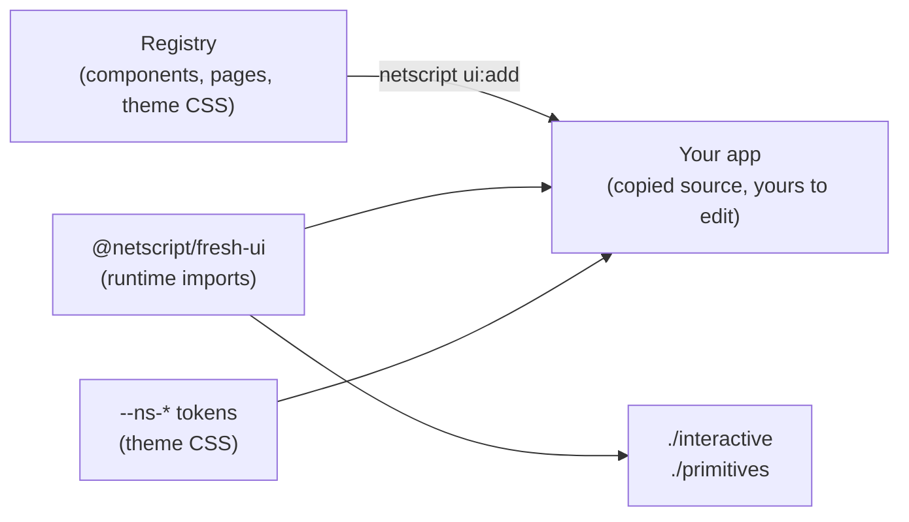

# @netscript/fresh-ui

[](https://jsr.io/@netscript/fresh-ui)
[](https://github.com/rickylabs/netscript/actions/workflows/ci.yml)
[](https://rickylabs.github.io/netscript/)

**The design system for NetScript's Fresh web surface: a copy-source component registry, a semantic
`--ns-*` token vocabulary, and a small package-owned runtime of accessible interactive primitives
and helpers.**

Component libraries force a choice: import a black box you cannot restyle, or copy code that drifts
the moment it lands. This package splits the difference. Components, pages, and theme CSS live in a
registry that the NetScript CLI copies **into your app** — from that point the code is yours to own
and evolve — while the genuinely shared parts (class merging, toast plumbing, icons, accessible
interaction state machines) stay in the package and update with it.

Everything copied and everything imported speaks one visual language: a theme-driven `--ns-*`
custom-property vocabulary that keeps components and themes decoupled. Restyle the app by swapping
tokens; the components never know.

## Why teams use it

- **Copy-source registry** — `netscript ui:init` installs the foundation, `netscript ui:add <item>`
  copies themed components, pages, and collections into your app; once copied, the code is yours.
- **Semantic token vocabulary** — registry CSS targets `--ns-*` custom properties, so themes and
  components stay decoupled and a token swap restyles the whole surface.
- **Accessible interactive primitives** — `Accordion`, `Combobox`, `Dialog`, `Drawer`, `Popover`,
  `Sheet`, `Tabs`, and `Tooltip` compound namespaces emit `data-part`, `data-state`, and ARIA
  attributes for styleable, accessible behavior.
- **Runtime helpers** — `cn` for class merging and the redirect-flash `withToast` / `getToast` /
  `stripToastFromUrl` cycle for carrying notifications across server redirects.
- **Generative-UI renderer** — `./ai/render-ui` safely renders AI `render_ui` tool payloads through
  a curated block whitelist, a recursion depth guard, and named fallbacks instead of throws.
- **AI surface collection** — `netscript ui:add ai` installs the chat seams: message thread,
  composer, model picker, tool-call disclosure, and the widget island that renders MCP `ui://`
  resources.
- **Native desktop chrome** — `createDesktopChrome` on `./desktop` activates application menus,
  tray, dialogs, notifications, and window actions around an existing Deno Desktop window, and
  returns an inert browser-safe lifecycle everywhere else.

`CodeBlock` highlights recognized `lang` names and aliases (such as `ts`, `javascript`, and `json`)
with the common highlight.js language set. Unknown or omitted languages remain plain text. Source
is escaped before syntax spans are added, and the copy payload remains the original source. The
copied component keeps clipboard handling in the app's island. Studio Utility binds the syntax
classes to its light/dark `code/syntax/*` roles.

## Architecture



## Install

```bash
deno add jsr:@netscript/fresh-ui@<version>
```

Pin `<version>` to match your installed CLI; bare `jsr:@netscript/*` specifiers do not resolve on
the pre-release line. In a scaffolded NetScript workspace, `netscript ui:init` wires the pinned
entry and the theme foundation for you.

## Quick example

The runtime helpers work anywhere Preact renders:

```typescript
import { cn, getToast, stripToastFromUrl, withToast } from '@netscript/fresh-ui';

// Merge class names safely (clsx + tailwind-merge semantics).
const buttonClass = cn('ns-btn', 'app-action');

// Carry a redirect-flash toast across a server redirect.
const redirectTo = withToast('/dashboard/deployments', {
  type: 'success',
  title: 'Deployment queued',
  message: 'api-gateway will roll out to three regions.',
});

// Read the toast back on the destination route, then clean the URL.
const url = new URL(`https://app.example${redirectTo}`);
const toast = getToast(url); // RegistryToast | undefined
const cleanPath = stripToastFromUrl(url); // '/dashboard/deployments'
```

Typed components come from the root entrypoint; stateful interactive components live on
`./interactive`, and headless layout primitives on `./primitives`:

```tsx
import { DataGrid } from '@netscript/fresh-ui';
import { Dialog } from '@netscript/fresh-ui/interactive';
import { Icon, Show, VisuallyHidden } from '@netscript/fresh-ui/primitives';

type Session = { name: string; tokens: number; status: string };

<DataGrid<Session>
  label='Recent sessions'
  columns={[
    { key: 'name', header: 'Session', cell: 'strong' },
    { key: 'tokens', header: 'Tokens', width: '8rem', cell: 'num' },
    { key: 'status', header: 'Status', render: (row) => <span>{row.status}</span> },
  ]}
  rows={[
    { id: 'vs3', data: { name: 'VS3', tokens: 18420, status: 'active' }, href: '/sessions/vs3' },
  ]}
/>;
```

Controlled collection actions are opt-in; omitting these props preserves the legacy grid markup:

```tsx
import { DataGrid } from '@netscript/fresh-ui';
import type { DataGridColumn, DataGridRow } from '@netscript/fresh-ui';
import { ActionMenu } from '@netscript/fresh-ui/interactive';

type Session = { name: string; tokens: number; status: string };

declare const columns: readonly DataGridColumn<Session>[];
declare const rows: readonly DataGridRow<Session>[];
declare const selectedIds: ReadonlySet<string>;
declare const setSelectedIds: (next: ReadonlySet<string>) => void;

<DataGrid<Session>
  columns={columns}
  rows={rows}
  selectedIds={selectedIds}
  onSelectionChange={setSelectedIds}
  renderBulkActions={({ count }) => <button>Archive {count}</button>}
  renderRowActions={(session) => (
    <ActionMenu.Root>
      <ActionMenu.Trigger aria-label={`Actions for ${session.name}`}>•••</ActionMenu.Trigger>
      <ActionMenu.Content>
        <ActionMenu.Item>Rename</ActionMenu.Item>
        <ActionMenu.Item intent='destructive'>Delete</ActionMenu.Item>
      </ActionMenu.Content>
    </ActionMenu.Root>
  )}
/>;
```

## API at a glance

| Entry            | What it gives you                                                                                |
| ---------------- | ------------------------------------------------------------------------------------------------ |
| `.`              | `cn`, `withToast` / `getToast` / `stripToastFromUrl`, `DataGrid`, `Icon`                         |
| `./interactive`  | `ActionMenu`, `Accordion`, `Combobox`, `Dialog`, `Drawer`, `Popover`, `Sheet`, `Tabs`, `Tooltip` |
| `./primitives`   | `Icon`, `Show`, `SrOnly`, `VisuallyHidden` — headless platform primitives                        |
| `./ai/render-ui` | `RenderUiSurface`, `renderUiPayload` — the safe generative-UI renderer                           |
| `./desktop`      | `createDesktopChrome` — menus, tray, dialogs, notifications, window actions                      |
| `./registry`     | The registry manifest and content map the CLI copies from                                        |
| `./tokens`       | DTCG sources, preset metadata and the IO-free Style Dictionary builder for tooling                |

The always-current symbol list is
[`deno doc jsr:@netscript/fresh-ui@<version>`](https://jsr.io/@netscript/fresh-ui/doc).

The token builder is a tooling entrypoint. Import it from CLI or build code:

```typescript
import { buildTokens } from '@netscript/fresh-ui/tokens';

const build = await buildTokens({
  preset: 'studio-utility',
  override: {
    semantic: {
      'radius-md': { $type: 'dimension', $value: '{semantic.radius-lg}' },
    },
  },
});
// The caller chooses the destination and writes the returned bytes.
console.log(build.files['tokens.css']);
```

All 24 presets, both schemes and both requested density contexts build through
Style Dictionary. Presets fix their own geometry. Studio Utility is the default for new applications; NS One remains a legacy preset;
Studio Utility is available as `theme-studio-utility` in the registry. The
three-tier source and extension guide is [tokens/README.md](tokens/README.md).

## Component contracts

Import types and the JSON serializer from `@netscript/fresh-ui/contracts`. This pure-data
subpath describes props, anatomy, data attributes, slots, APG patterns, keyboard maps and token
roles shared by styles. It performs no IO. See [the contributor guide](src/contracts/README.md)
for native, pseudo-element and planned-part representations.

## Docs

- **Web layer — the design system in context**:
  [rickylabs.github.io/netscript/web-layer/](https://rickylabs.github.io/netscript/web-layer/)
- **Reference**:
  [rickylabs.github.io/netscript/reference/fresh-ui/](https://rickylabs.github.io/netscript/reference/fresh-ui/)
- **How-to — customize Fresh UI**:
  [rickylabs.github.io/netscript/how-to/customize-fresh-ui/](https://rickylabs.github.io/netscript/how-to/customize-fresh-ui/)
- **API docs on JSR**: [jsr.io/@netscript/fresh-ui/doc](https://jsr.io/@netscript/fresh-ui/doc)

## Compatibility

Runs on Deno 2.x with Preact; the runtime helpers are pure functions and render in any modern
browser. Registry copy commands (`netscript ui:*`) require the NetScript CLI.

## License

Apache-2.0 — see [LICENSE](https://github.com/rickylabs/netscript/blob/main/LICENSE). Published to
JSR with cryptographically verified provenance.

Token build metadata is available from `@netscript/fresh-ui/token-config` without
loading Style Dictionary or the source corpus. See [token contribution and output
budgets](tokens/README.md). Design preview styles are opt-in through
`netscript ui:add theme-previews` or `netscript tokens build --previews`.

The catalog is available as `componentContracts` from `./contracts`, or as a JSON module:

```ts
import { componentContracts, serializeComponentContracts } from '@netscript/fresh-ui/contracts';
import catalog from '@netscript/fresh-ui/contracts.json' with { type: 'json' };

console.log(componentContracts.components.find((component) => component.name === 'button'));
console.log(serializeComponentContracts(componentContracts));
console.log(catalog.schemaVersion);
```

The catalog covers all 104 Figma inventory identities. `shipped: false`, planned values and
native/pseudo parts distinguish specified anatomy from a rendering implementation. Phase 2
adds registry components with real render and browser keyboard coverage; it preserves token values.

The `actions` collection includes ButtonGroup, Toggle and ToggleGroup. The `forms-core`
collection includes RadioGroup, InputGroup, InputOTP, Slider, Calendar and DatePicker.
Install individual items with `netscript ui:add calendar` or `netscript ui:add date-picker`.
Hydrate interactive controls inside a Fresh island.

Calendar accepts ordered ISO date strings through `value`/`defaultValue`, plus
`mode='single' | 'range'`, `months={1 | 2}`, `caption='label' | 'dropdown'`,
`min`/`max`, `isDateDisabled`, `weekStartsOn` and `onValueChange`. Its `today`
default is UTC; supply the user's local ISO day when local-day highlighting is needed.
Arrow keys browse enabled dates, Home/End move within the week, PageUp/PageDown
move months (Shift moves years), and Enter/Space select.

DatePicker adds a required `label`, optional form `name`, and independently controlled
`open`/`onOpenChange`. Its native modal Dialog supports Escape/Cancel and returns focus
to the trigger. Selection requests respect controlled values; ordinary closing requests respect
controlled open state. Browser-forced dismissal (such as repeated Escape) remains
native behavior; apps should normally accept native close requests. Reopening starts on the selected month. A named hidden input
submits the ISO date, or range endpoints joined by `/`.

The `navigation` collection adds NavigationMenu, Menubar, LocationMarker and Stepper.
NavigationMenu uses native exclusive details disclosures and ordinary site links.
Menubar accepts menu records with actions, controlled checkbox/radio choices,
labels, separators and nested submenu records. It delegates native popovers to
ActionMenu; arrow keys, Home/End, typeahead, Escape and Tab follow the application
menu pattern. Hydrate it in an island; application callbacks and choice state
belong to the app. `value`/`onValueChange` may control the open menu ID (`null` closes).

ActionMenu.Item supports `role='menuitemcheckbox' | 'menuitemradio'`, native
`aria-checked`, and `closeOnSelect={false}` for repeated choice adjustments.
ActionMenu.Content supports `initialFocus='first' | 'last'`. Outside dismissal
keeps the destination focus; explicit Escape/close actions return to the trigger.
Stepper is an ordered list with per-step status and optional native links, and
LocationMarker is decorative. Neither adds a composite keyboard manager.

The `overlays` collection adds AlertDialog, HoverCard and ContextMenu. AlertDialog
requires trigger/title/description/action labels and delegates modal focus to
Dialog; Cancel is the initial focus target and outside clicks do not dismiss.
Application callbacks, pending state and controlled open state remain caller-owned.
HoverCard opens on hover, focus or button activation without moving focus, and
keeps content usable across pointer transfer. Touch/pen use activation-only toggles;
mouse hover previews and a subsequent click closes the preview. Its description/meta/avatar are
content slots. ContextMenu accepts ordinary region content plus menu records,
opens at pointer coordinates or with Shift+F10/ContextMenu, and shares the
action/choice/submenu behavior of Menubar. Hydrate these controls in islands.

AlertDialog's Utility destructive action temporarily inverts the existing
destructive-text/card pair to keep small text readable. The canonical
destructive/default palette remains owned by the token workstream; no palette
values change here.

Data display additions: `ui:add item kbd collapsible` copies presentation rows, native keyboard notation and native details disclosures. Item retains native child links/actions; Kbd adds no focus targets; after hydration, Collapsible supports controlled open refusal and blocks disabled summary activation. Before hydration, its summary retains native disclosure behavior.

`ui:add chart carousel` adds token-driven Cartesian series and a manual native scroll-snap carousel. Chart accepts one to three labeled `series` and `data` rows with matching finite numeric `values`; its native data disclosure exposes exact values to keyboard and assistive technology. Hover is supplemental. Carousel supports horizontal/vertical orientation, inside/outside controls, dots, counter and a clamped `defaultIndex`; it has no autoplay. Boundary controls retain focus with guarded `aria-disabled`, and inactive slide content becomes inert after hydration.

Chart uses an explicit `locale` (`en-US` by default) for consistent server/client number formatting. When native carousel scrolling moves away from a focused slide link, focus moves to the existing scroll viewport before that slide becomes inert; previous/next/dot focus stays on its native control.

`ui:add code-block` copies single-file, tabbed and diff code surfaces. Hydrate the component in an island for file selection and clipboard feedback. `tabs` contains uniquely keyed `{ value, label, code?, filename?, lang?, lines? }` files; `value`/`defaultValue` and `onValueChange` control selection. Horizontal arrows follow the document direction; Home/End select the first/last file. Code itself retains left-to-right native horizontal scrolling. `header={false}` hides optional metadata/copy chrome while retaining essential file tabs.

`lineNumbers`, `footer`, `footerContent`, `scrollbar`, `size` and `tone` customize the surface. Diff `lines` carry raw `text`, optional `number` and `variant` (`default`, `added`, `removed`, `highlighted`); visible plus/minus signs supplement color. Plain text is escaped. Trusted syntax content can use `CodeBlock.Token` with existing keyword/function/type/string/number/comment/punctuation roles. Clipboard writes use the exact `code` when supplied, otherwise resulting row text excluding removals. `onCopied(source)` and `onCopyError(error)` report actual outcomes; native `onCopy` remains a DOM clipboard event. A pending copy cannot mark a newly selected file copied. The optional `state` prop is a controlled visual snapshot. Published phase-one variant/header aliases remain supported.

Syntax colors use existing code roles on `code/bg`. Tinted diff/highlight rows currently use `text/fg` to maintain small-text contrast; their syntax slots and diff signs remain intact.

Legacy `header="tabs"` without a file collection renders the filename/copy header (`data-header="title"`); only explicit `variant="tabbed"` requires a nonempty file collection. The contract retains the legacy alias list alongside its boolean chrome control.

`Label variant='eyebrow'` uses the existing Utility metadata typography. `optional`/`optionalText` add a hint; `required` takes precedence. `srOnly` keeps the native accessible name without a visible label. `state='disabled' | 'invalid'` styles the label; set disabled/invalid semantics on the associated input itself. Native `for`/`htmlFor` association and scope overrides remain available.

`Card variant='rule' size='sm'` provides the docs surface with a top border, no resting fill/radius/shadow and compact sections. Existing Header/Title/Description/Body/Footer composition remains, with optional `Card.Action`. Section visibility follows composition. `interactive` enables hover/focus-within styling; the card adds no aggregate tab stop or click handler. Native child actions retain their behavior; `state` can supply a visual snapshot.

`Pagination variant='pager'` composes `Pagination.Previous` and `Pagination.Next` with native `href` destinations and automatic previous/next relations. Numbered pagination retains Meta/Actions and adds Link/current/disabled plus decorative Ellipsis. Disabled destinations have no href or tab stop and block activation callbacks. Horizontal arrows mirror with document direction; narrow layouts stack document tiles. The existing Icon primitive also supports arrow-left/right, sourced from [Lucide](https://lucide.dev/icons/arrow-left) with its Lucide/Feather notices retained in source.
