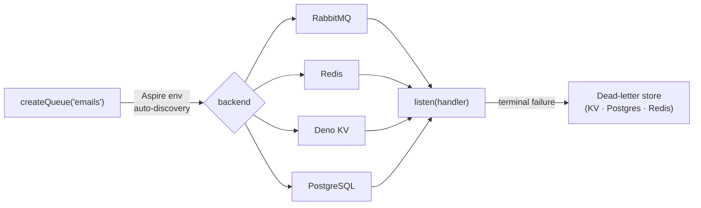

# @netscript/queue

[](https://jsr.io/@netscript/queue)
[](https://github.com/rickylabs/netscript/actions/workflows/ci.yml)
[](https://rickylabs.github.io/netscript/)

**A provider-agnostic message queue for NetScript: enqueue and drain background jobs through one
`MessageQueue` contract, auto-discovering a RabbitMQ, Redis, or Deno KV backend from the Aspire
environment.**

Queue code has a habit of marrying its broker: the day you move from Deno KV to RabbitMQ, every
`enqueue` and every consumer changes. `@netscript/queue` keeps the contract and the broker separate.
`createQueue('emails')` inspects the Aspire environment, picks the best available backend, and
returns a `MessageQueue<T>` whose call sites are identical from an in-memory test run to a
production broker. Validation, dead-lettering, and error taxonomy are part of the contract, not
afterthoughts bolted onto one adapter.

## Why teams use it

- **One contract, four backends** — every adapter implements the same `MessageQueue<T>` interface,
  so `enqueue` and `listen` never change when the broker does.
- **Backend auto-discovery** — `createQueue` resolves RabbitMQ, then Redis, then Deno KV from Aspire
  service URLs and environment variables; pin one explicitly with `QueueProvider` plus
  `QueueConnectionOptions`.
- **Typed queues** — `createTypedQueue` adds schema validation on enqueue and dequeue, routing
  invalid messages to discard, throw, or the dead-letter store.
- **Durable dead letters** — terminal failures are recorded through the `DeadLetterStorePort`
  contract, with KV, PostgreSQL, and Redis stores published under dedicated sub-path exports.
- **Lazy adapter graph** — the root export carries only factories, ports, errors, and validation
  helpers; Redis and RabbitMQ drivers load on first use, so common imports stay light.
- **Structured failure taxonomy** — `QueueError` subclasses (`QueueConnectionError`,
  `QueueValidationError`, `QueueHandlerError`, …) and `QueueErrorCode` make failures matchable
  instead of string-parsed.

## Architecture



## Redis claim leases and recovery

The Redis adapter delivers work **at least once**. Each delivery has a unique fenced receipt,
a visibility deadline, and a persisted delivery count. A consumer that exits before acknowledging
leaves a durable claim. Another consumer returns that message to the ready queue after the lease
and recovery grace expire; the next handler sees the same `messageId` and `deliveryCount: 2`.
After the configured delivery limit, expiry or a requeuing nack writes a structured dead-letter
record with reason `max_attempts_exceeded`. Explicit terminal nacks retain their reason and error
metadata. Handler errors retain the existing listener error behavior after settling the claim.

Configure Redis listeners with `visibilityTimeout` (milliseconds, default 30,000), `maxDeliveries`
(including the first delivery, default 5), and `recoveryGrace` (milliseconds, default 1,000).
The listener honors `ListenOptions.concurrency` (default 1), admitting at most that many handlers
including their acknowledgement work. Concurrency must be a positive integer no larger than
2147483647. Each delivery has its own receipt and heartbeat; slow handlers do not hold other slots.
Recovery runs independently while handlers are working; an idle listener polls every 50 ms by
default. Recovery examines at most 100 expired claims and 100 legacy processing entries per pass.

Long jobs must call `await context.extendVisibility?.(milliseconds)` periodically before their
current lease expires. Omit the argument to extend by the original visibility timeout. A `false`
result means ownership expired or changed: stop performing effects for that receipt. Expired or
replaced acknowledgements and nacks are refused and counted; they cannot settle a later delivery.

The first-party workers plugin renews job and task deliveries automatically: it requests a
60-second lease before dispatch and renews every 20 seconds until execution finishes. Lease loss
or renewal failure cancels the job/subprocess and prevents successful application being recorded.
Custom queue consumers remain responsible for their own heartbeat.

Use `await redisQueue.getMetrics()` to read durable `reclaimed`, `deadLettered`,
`staleSettlements`, and `observedOrphans` counters. `await redisQueue.getHealth()` includes these
counters plus `ready`, `processing`, `deadLetterDepth`, and `outboxDepth`. The explicit
`await redisQueue.reclaimExpired()` seam runs one bounded recovery pass without starting a listener.
Counters survive consumer process restarts. These methods are available on `RedisAdapter` from
`@netscript/queue/adapters/redis`.

Handler effects and acknowledgement are separate transactions. If an effect succeeds and its
acknowledgement is lost, the job can run again with the same message ID and a higher delivery count.
Use the message ID or your domain idempotency key to deduplicate effects. A heartbeat protects
ownership; it does not make application effects exactly once.

The default dead-letter destination is the existing Redis DLQ list. A configured external
`DeadLetterStorePort` receives records through a durable Redis outbox: failed writes remain in the
outbox and are retried independently by recovery polling. A failed or slow external store does not
stop consumption or lease recovery. External stores must honor the port's idempotent append
contract. Use the built-in Redis store as the default rather than as an external mirror, since its
append operation does not deduplicate repeated writes. Health exposes pending outbox records.

### Upgrading existing Redis and Garnet queues

Existing ready lists, delayed entries, and dead-letter records retain their format. Recovery also
observes old processing entries without receipts, gives each a fresh visibility lease, then permits
recovery only after that lease and grace expire. Quiesce old consumers before upgrading: old code
cannot fence its byte-based acknowledgements. Receipts retain the payload even if an old worker
removes its processing entry, so migration can repeat already-applied effects.

Redis requires scripting permission. **Garnet requires both `--lua` and `--lua-transaction-mode`**
(or `EnableLua: true` and `LuaTransactionMode: true` in its configuration). New CLI scaffolds pass
both flags in Container, Executable, and Auto fallback launches. For existing scaffolds, regenerate
the infrastructure helper or add both flags to the managed Garnet launch before upgrading the
consumer. Configure externally managed Garnet similarly. Scripting is checked before consumption;
a server without it fails without removing ready work. Leases intentionally have no unsafe
non-scripting fallback. These options follow the [Garnet configuration reference](https://microsoft.github.io/garnet/docs/getting-started/configuration).

The lease implementation is in `adapters/_redis-lease.ts` and `_redis-lease-script.ts`. Every
transition declares all keys for Garnet's transactional locking. It validates destination types and
inserts into the destination before deleting source claim data. Receipt envelopes remain opaque
JSON strings inside Lua, preserving payload number precision. Extending this seam should retain
its real Redis/Garnet crash, heartbeat, fencing, and delivery-limit tests.

## Install

```bash
deno add jsr:@netscript/queue@<version>
```

Pin `<version>` to match your installed CLI; bare `jsr:@netscript/*` specifiers do not resolve on
the pre-release line.

## Quick example

```typescript
import { createQueue } from '@netscript/queue';

declare function sendWelcomeEmail(to: string, body: string): Promise<void>;

// Auto-discovers a backend (RabbitMQ → Redis → Deno KV) from the Aspire environment.
const queue = createQueue<{ to: string; body: string }>('emails');

await queue.enqueue({ to: 'user@example.com', body: 'Welcome to NetScript.' });

await queue.listen(async (message) => {
  await sendWelcomeEmail(message.to, message.body);
});
```

For runtime schema validation at enqueue and dequeue time, define the contract with a Zod schema and
build a typed queue:

```typescript
import { z } from 'zod';
import { createTypedQueue } from '@netscript/queue';

const NotificationSchema = z.object({
  type: z.enum(['email', 'sms']),
  to: z.string(),
  body: z.string(),
});

const queue = createTypedQueue('notifications', NotificationSchema, {
  onValidationError: 'dlq',
});
```

## Public surface

| Entry                                   | What it gives you                                                                                    |
| --------------------------------------- | ---------------------------------------------------------------------------------------------------- |
| `.`                                     | `createQueue`, `createTypedQueue`, `createParallelQueue`, validation helpers, errors, contract types |
| `./ports`                               | Contract types only (`MessageQueue`, `DeadLetterStorePort`, options)                                 |
| `./adapters/deno-kv`                    | Deno KV adapter (native queue operations)                                                            |
| `./adapters/kv-polling`                 | Deno KV polling adapter for hosts without native queue support                                       |
| `./adapters/redis`                      | Redis adapter                                                                                        |
| `./adapters/amqp`                       | RabbitMQ (AMQP) adapter                                                                              |
| `./adapters/postgres`                   | PostgreSQL adapter                                                                                   |
| `./adapters/*-dead-letter-store`        | Durable dead-letter stores for KV, PostgreSQL, and Redis                                             |
| `./validation`, `./errors`, `./testing` | Validation helpers, error taxonomy, test utilities                                                   |

The always-current symbol list is
[`deno doc jsr:@netscript/queue@<version>`](https://jsr.io/@netscript/queue/doc) (pin `<version>` on
the pre-release line, as above).

## Docs

- **Reference — factories, adapters, and exports**:
  [rickylabs.github.io/netscript/reference/queue/](https://rickylabs.github.io/netscript/reference/queue/)
- **Background Processing — how queues fit the background stack**:
  [rickylabs.github.io/netscript/background-processing/](https://rickylabs.github.io/netscript/background-processing/)
- **How-to: choose a queue provider**:
  [rickylabs.github.io/netscript/how-to/choose-a-queue-provider/](https://rickylabs.github.io/netscript/how-to/choose-a-queue-provider/)
- **API docs on JSR**: [jsr.io/@netscript/queue/doc](https://jsr.io/@netscript/queue/doc)

## Redis dispatch and shutdown

`listen(handler, { concurrency: 4, pollIntervalMs: 20, delayedPollIntervalMs: 20 })` overlaps four
handlers on the same event loop. Both intervals accept integer milliseconds from 10 to 60000.
Defaults are 50 ms for idle pickup and 1000 ms for delayed promotion. Explicit options override
`NETSCRIPT_REDIS_QUEUE_POLL_INTERVAL_MS` and `NETSCRIPT_REDIS_DELAYED_POLL_INTERVAL_MS`, then defaults.
Invalid values fail before connections are allocated. If a scoped environment permission denies
access, defaults apply; explicit values require no access to these environment variables. Other
providers ignore these Redis-specific intervals.

With a free slot, healthy backend, no promotion backlog and a responsive event loop, the polling
contribution to ready pickup is at most `pollIntervalMs`; delayed pickup after eligibility adds at
most `delayedPollIntervalMs + pollIntervalMs`. Redis command time, clock differences and event-loop
scheduling are additional. This is not an unconditional wall-clock SLA: saturated workers, outages,
large or invalid delayed backlogs and blocked synchronous JavaScript have no fixed pickup bound.
See [Tune the worker runtime](https://rickylabs.github.io/netscript/background-processing/how-to/tune-worker-runtime/).

Abort stops admission. A claim already committed still reaches its handler; in-flight handlers and
fenced acknowledgements drain for up to `visibilityTimeout` (default 30000 ms), starting at abort,
stop or listener failure. `stop()` awaits that same drain before disconnecting. Claims left when
the budget expires remain durable for reclaim, and the old contexts cannot acknowledge or renew.
Calling and awaiting `stop()` inside its own handler consumes the drain budget and leaves that
handler's claim for recovery. Signal cancellation to the host instead when the handler should
finish and acknowledge normally. Handlers must respect their application's cancellation signal;
the drain cannot terminate JavaScript or undo effects. First-party workers retain their existing
per-delivery renewal and cancellation policy.

## Compatibility

Redis delayed-message promotion is at most once across listeners sharing a delayed key. The adapter
opens its dedicated promotion connection lazily and caches Lua support once per client (transport
failures leave capability undetermined). With scripting available, each due member is removed and
pushed atomically by Lua; only a successful `ZREM` can push its recorded envelope. The script is
loaded once and batches send `EVALSHA`, reloading/retrying once on `NOSCRIPT`. `redis.pcall` catches
a failed `LPUSH` and restores the member at its original score inside the same script. Immediate
ready-list enqueues/dequeues cannot abort this path. Both keys are passed explicitly as `KEYS`, and
envelope bytes/routing are unchanged.

Delayed promotion retains a compatibility fallback for servers without scripting, including Garnet
with Lua disabled; queue consumption still requires the Lua settings above. This fallback uses
`WATCH`/`MULTI`/`EXEC`. Only the
delayed set is watched; hot ready lists are type-checked in a pipelined preflight without WATCH.
Wrongly typed targets found in preflight are logged and retained. This fallback accepts the narrow
race where a target is changed to a non-list after preflight: Redis does not roll back EXEC, so that
race can lose the member. Queue keys must stay absent or lists while consumers operate. A connection
epoch counts close/end/ready events; a changed epoch abandons the snapshot before MULTI so a
reconnect cannot commit it without WATCH. Delayed-set writes can still abort this path: each poll
has three attempts per batch with 1–5 ms jitter, then defers to the next configured delayed poll (default 1 s). Continuous
delayed writes therefore have no fixed promotion-latency bound.

Both paths read at most 100 due members per attempt and continue while a full batch is promoted, up
to ten batches (1,000 members) per pass. Larger backlogs continue on the next configured delayed poll; no batch
allocates or reads the whole backlog. There is no poison-member skip/quarantine: 100 retained
wrongly typed targets can block valid members behind them, and invalid JSON halts its batch. Repair
those keys/members to resume progress. Handler retries still require idempotency. The promotion
client disables the offline queue: best-effort polls fail fast and quietly while connecting or
reconnecting. Unexpected pass failures are logged once, and timer rejections are caught. Shutdown
disconnects all clients and races the active pass against its manual-disconnect signal, abandoning
unresolved work even when ioredis emits no close event. A manually closed client never reconnects;
abandoned server-side operations either committed atomically or wrote nothing.

The existing `netscript:queue:<name>`, `netscript:processing:<name>`, and `netscript:delayed:<name>`
key layout is unchanged and targets single-node Redis-compatible servers. Redis Cluster is outside
this adapter's supported scope: these keys have no shared hash tag, so multi-key lease and promotion
operations can cross hash slots.

Designed for Deno. The Deno KV backend needs the `kv` unstable feature (`--unstable-kv`); Redis,
RabbitMQ, and PostgreSQL backends need `--allow-net` plus `--allow-env` for discovery. Backend
auto-discovery reads Aspire-style service environment variables and falls back to Deno KV when no
broker is advertised.

## License

Apache-2.0 — see [LICENSE](https://github.com/rickylabs/netscript/blob/main/LICENSE). Published to
JSR with cryptographically verified provenance.
