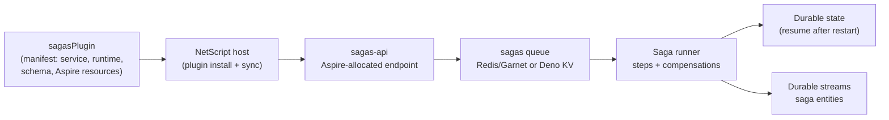

# @netscript/plugin-sagas

[](https://jsr.io/@netscript/plugin-sagas)
[](https://github.com/rickylabs/netscript/actions/workflows/ci.yml)
[](https://rickylabs.github.io/netscript/)

**The saga-orchestration plugin for NetScript: one install wires durable multi-step workflows with
compensation, a Saga API service, saga CLI commands, and Aspire orchestration into your app.**

Long-running business flows — checkout, onboarding, provisioning — fail in the middle, and the code
that unwinds a half-finished flow is the code nobody gets right ad hoc. `@netscript/plugin-sagas`
ships saga orchestration as one declarative manifest: `netscript plugin install saga` scaffolds a
sagas workspace, registers the Saga API service, provisions durable state storage, and adds the saga
runtime to your Aspire AppHost so in-flight workflows survive restarts and resume deterministically.

The manifest is plain data. Hosts read it to generate files and wiring; nothing executes until your
app boots. The saga DSL, engine, and runtime ports live in
[`@netscript/plugin-sagas-core`](https://jsr.io/@netscript/plugin-sagas-core) — this package binds
them to a NetScript host.

## Why teams use it

- **One manifest, whole capability** — `sagasPlugin` declares the Saga API service, the saga
  runtime, stream topics, database schema, runtime-config topics, contract versions, and Aspire
  resources as typed contribution axes the host turns into running processes.
- **Compensation built in** — workflows declare forward steps and compensations; saga state is
  persisted so a crash mid-flow resumes instead of stranding half-applied effects.
- **Saga API included** — the Aspire-discovered `sagas-api` service backs saga and instance
  introspection over a versioned contract. Publish durably enqueues for the background runner and
  returns a non-2xx response on enqueue failure or deadline expiry.
- **An operations CLI** — `list`, `inspect`, `add-saga`, `update-saga`, `remove-saga`,
  `generate-registry`, and `publish` cover authoring and inspection; `inspect` degrades gracefully
  to a local source scan when the Saga API is not running.
- **Stable identity constants** — `SAGAS_PLUGIN_ID` and `SAGAS_API_SERVICE_NAME` identify the
  contribution. `SAGAS_API_DEFAULT_PORT` remains a deprecated compatibility-only export and is not a
  runtime fallback.
- **Durable streams + Aspire** — `./streams` publishes saga entities to durable stream topics;
  `./aspire` contributes the saga resources to the AppHost.

## Excluding helpers from generated registries

`netscript generate plugins` selects definition modules from `sagas/*-saga.ts`. Keep a helper or a
dependency-injected factory beside those definitions by putting this exact comment on its first
line:

```ts
// @netscript-registry-ignore
export function scopedId(scope: string, name: string): string {
  return `${scope}.${name}`;
}
```

For example, add it to `sagas/factory-saga.ts`. The directive is shared by all plugin runtime
registries and standalone registry compilers. It excludes the whole module before generating
imports; ordinary imports from your application keep working. Use a separate module for a top-level
saga definition that should remain registered.

The marker must be the complete first-line comment, before any license header or code. Indentation,
a UTF-8 BOM and CRLF are accepted; a later comment, a string containing the marker, or extra text on
the line does not opt out. Existing manifest suffix and filename exclusions still apply.

Regenerate and inspect the result:

```sh
netscript generate plugins
netscript plugin doctor
```

Doctor names eligible modules carrying the directive as `Explicitly excluded registry modules`, on
both healthy and stale registries. Remove the directive and regenerate to register the module again.
Sagas already skips modules without statically discovered definition calls; the explicit exclusion
report covers otherwise eligible saga definition or factory modules. Unmarked modules retain the
plugin's existing definition validation. Keep the CLI, shared plugin package and installed plugins
on matching release versions so their selector and inspection protocol agree.

## Architecture



## Install

From the root of a NetScript project:

```bash
netscript plugin install saga --name sagas
```

The plugin owns its setup — the CLI ships no embedded templates. The scaffolder wires the Saga API
service, the saga runtime, stream topics, database schema, and Aspire resources into your workspace,
then pins the matching `@netscript/*` versions. Sagas require Deno KV and optionally Postgres for
durable state (`--saga-store-backend kv|prisma`); the install records these requirements so
`netscript db` and Aspire provision them for you.

To consume the plugin programmatically (custom hosts, tests, tooling), add it as a library:

```bash
deno add jsr:@netscript/plugin-sagas@<version>
```

The standalone plugin CLI is also directly runnable:

```bash
deno x -A jsr:@netscript/plugin-sagas@<version>/cli inspect
```

Pin `<version>` to match your installed CLI; bare `jsr:@netscript/*` specifiers do not resolve on
the pre-release line.

## Quick example

Install the plugin, then inspect the saga surface — with no Saga API running, `inspect` reports the
runtime as unreachable and still scans local saga sources:

```bash
$ netscript plugin install saga --name sagas
Installed saga plugin "sagas" with an Aspire-allocated endpoint.
Created 4 plugin files.
Regenerated 12 Aspire helper files.

$ deno x -A jsr:@netscript/plugin-sagas@<version>/cli inspect
Found 0 saga source files.
{
  "source": "local",
  "runtimeError": "fetch failed",
  "roots": [
    "sagas"
  ],
  "entries": []
}
```

As a library, the manifest and identity constants are inspectable data:

```typescript
import {
  SAGAS_API_DEFAULT_PORT,
  SAGAS_API_SERVICE_NAME,
  SAGAS_PLUGIN_ID,
  sagasPlugin,
} from '@netscript/plugin-sagas';

console.log(SAGAS_PLUGIN_ID); // "sagas"
console.log(SAGAS_API_SERVICE_NAME); // "sagas-api"
console.log(SAGAS_API_DEFAULT_PORT); // deprecated compatibility value; do not use for discovery
console.log(sagasPlugin.name); // "@netscript/plugin-sagas"
```

## Public surface

| Entry         | What it gives you                                                    |
| ------------- | -------------------------------------------------------------------- |
| `.`           | `sagasPlugin` plus the `SAGAS_*` identity and service constants      |
| `./cli`       | The saga command group (`list`, `inspect`, `add-saga`, `publish`, …) |
| `./runtime`   | The saga execution runtime composition                               |
| `./public`    | The typed orchestration surface hosts re-export                      |
| `./services`  | The Aspire-discovered Saga API service composition (`sagas-api`)     |
| `./streams`   | Durable-stream factory for saga entities                             |
| `./aspire`    | The saga Aspire contribution for the AppHost                         |
| `./contracts` | The versioned saga API contract generated registries bind against    |
| `./scaffold`  | The plugin-owned scaffolder `netscript plugin install saga` executes |

The always-current symbol list is
[`deno doc jsr:@netscript/plugin-sagas@<version>`](https://jsr.io/@netscript/plugin-sagas/doc) (pin
`<version>` on the pre-release line, as above).

## Docs

- **Sagas reference — commands, service, and contract**:
  [rickylabs.github.io/netscript/reference/sagas/](https://rickylabs.github.io/netscript/reference/sagas/)
- **Background Processing — sagas alongside jobs and triggers**:
  [rickylabs.github.io/netscript/background-processing/](https://rickylabs.github.io/netscript/background-processing/)
- **Checkout saga tutorial — build a multi-step saga end to end**:
  [rickylabs.github.io/netscript/tutorials/storefront/04-checkout-saga/](https://rickylabs.github.io/netscript/tutorials/storefront/04-checkout-saga/)
- **API docs on JSR**:
  [jsr.io/@netscript/plugin-sagas/doc](https://jsr.io/@netscript/plugin-sagas/doc)

## Compatibility

The saga runtime, CLI, and Saga API service require Deno 2.9+ (they use `Deno.*` and Deno KV APIs).
The manifest itself is plain data and can be imported anywhere TypeScript runs.

## License

Apache-2.0 — see [LICENSE](https://github.com/rickylabs/netscript/blob/main/LICENSE). Published to
JSR with cryptographically verified provenance.

## PostgreSQL command retention

The sagas plugin contributes `NetScriptCommandOutbox` and `SagaRuntimeCommandAppliedKey` through its
installed Prisma schema. SQL sidecars supply the reviewed outbox CHECK constraints; the normal
application migration command appends pending contributions before deployment. Existing equivalent
copied models are deduplicated without dropping their tables.

Use `createPrismaSagaCommandRetention` from `@netscript/plugin-sagas-core/stores` in the existing
background retention job. Pass the saga groups' completed-days policy as
`completedRetentionDaysBySaga` (seven-day default), and persist `nextCursor` between invocations.
Each page examines/deletes at most 100 rows per family. Pending/leased outbox records and active
saga markers survive; terminal marker age starts at completion, and deletion rechecks fresh state.
Keep canonical state until replay markers are gone. The shared outbox window defaults to the longest
configured saga window.

See the
[schema, migration and cursor recipe](https://rickylabs.github.io/netscript/reference/plugin-sagas-core/#installed-outbox-schema-and-postgresql-retention).

## Compensation persistence and retry

`SagaEngine.commitCompensation` uses the same `SagaTransitionCommitPort` as an ordinary saga
transition. Its replay identity includes the saga, instance and version being compensated. The
replay digest, next state, correlation ownership and transition history commit together:

| Canonical store                                 | Guarantee                                                                                                                                                |
| ----------------------------------------------- | -------------------------------------------------------------------------------------------------------------------------------------------------------- |
| `KvSagaStore` on Deno KV                        | One atomic compare-and-swap includes every row and the replay digest. A rejected write leaves the previous `compensating` state and no committed digest. |
| `KvSagaStore` on Redis                          | The same atomic batch commits through the Redis adapter; reopening the store preserves the same state/replay relationship.                               |
| `PrismaSagaStore` on PostgreSQL                 | The replay insert and state/history writes share one interactive transaction. A failure after the insert rolls it back with the other rows.              |
| `createPrismaSagaTransitionStore` on PostgreSQL | The existing transaction commits compensation state and replay together, including when the adapter also supports worker-command intents.                |

Retry the **same compensation outcome**, with its original expected version, after a persistence
failure. If the transaction failed, the retry can commit; if the commit succeeded but its
acknowledgement was lost, the retry returns `committed: false` without appending another transition.
This also applies to outcomes that record a compensation handler error as `failed`.

Custom stores must implement the atomic state/replay capability before registration. Granular stores
without it are rejected before handlers execute. `MemorySagaStore` supplies the same logical
contract for tests, without persistence across process restarts.

These guarantees concern canonical compensation outcomes. Redelivering an already committed inbound
message does not reconstruct its cascades. Automatic recovery of scheduled/cascaded effects after
the inbound commit requires the separate effects dispatcher; retrying an outcome does not provide
that delivery guarantee. Query projections also remain separate from the canonical commit.

## KV retention

Topic groups declare `retention.completedDays` (default 7) and `retention.archiveToDb` (default
false). Open `pending`, `running`, and `compensating` instances retain canonical state,
correlations, transition history, applied replay keys, and the KV query projection until they become
terminal. `activeDays` is a legacy active-window hint; it does not expire live replay data.

Terminal `completed`, `failed`, `cancelled`, and `compensated` instances expire after
`completedDays`, measured from the terminal timestamp. Canonical state, forward and reverse
correlations, new terminal transitions, and `saga_instances` query documents use KV `expireIn`. The
saga service applies the same deadline to earlier transitions and applied keys in atomic pages of at
most 10 entries (12 checks and 11 mutations including state and cursor), conservatively bounded for
Deno KV's mutation byte budget even for full-size values. A persistent `sagas/retention` cursor
resumes that work after restart and is deleted once all history has received its TTL. Low-level
`KvSagaStore` callers must drive `cleanupRetention()`; it returns whether work remains. The shipped
durable runtime drains backlog without a polling delay, backs off from 100 ms to 30 seconds while
idle, and logs/retries transient sweep failures with exponential backoff. Retention failures do not
prevent runtime startup. A backlog can delay migration of historical keys, so backend expiry alone
is guaranteed only after their terminal deadline has been assigned. No API read or owner app session
drives cleanup.

Transport reservations already use their separate deduplication TTL. With a KV query projection,
`archiveToDb: true` explicitly enables the optional Prisma archive for that saga group and requires
a host Prisma client. The default `archiveToDb: false` skips it, keeping KV-only installs DB-free.
With `Sagas.Projection.Backend: prisma`, the Prisma query model remains required runtime state so
`listInstances`, `getInstance`, and stream hydration stay populated independently of archival.

Migration: `KvSagaAppliedKeyStore.activeTtlMs` is deprecated and no longer expires open replay
markers. Configure `completedRetentionDays` to match the canonical terminal window instead. Markers
survive open instances and receive their deadline only after terminal state.

Delayed saga messages remain owned by the queue adapter. The queue scheduling port currently has no
terminal-instance cancellation/expiry contract, so their retention window is not proven by this
change. Terminal records written before this policy was installed also need a migration/backfill;
this change assigns deadlines when a terminal state is written. These remaining acceptance items
keep issue #2109 open.
